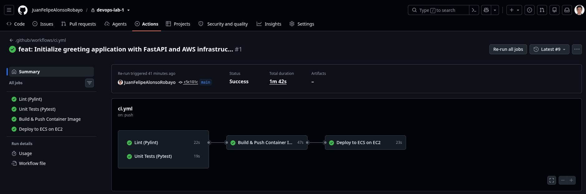
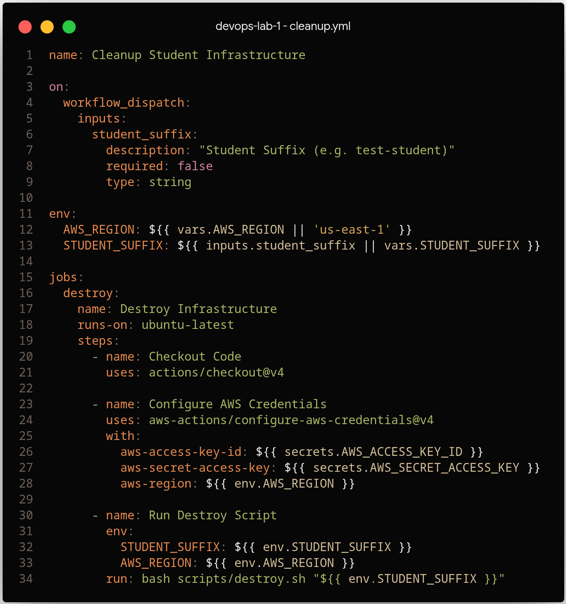
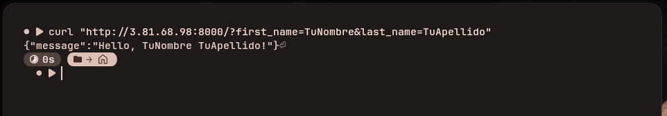

# Laboratorio 1: CI/CD y Contenedores en AWS

Este documento presenta la solución desarrollada para el laboratorio, explicando el funcionamiento del contenedor, la estructura del pipeline, las evidencias de las pruebas realizadas y algunas propuestas de mejora para el flujo de trabajo.

---<>

## 1. Arquitectura de Contenedores y CI/CD

### Funcionamiento del contenedor
Para empaquetar la aplicación en FastAPI se utilizó Docker aplicando las siguientes decisiones de diseño:
* **Imagen base liviana (`python:3.12-slim`):** Se optó por una versión reducida de Python para mantener la imagen ligera, acelerar los tiempos de descarga y evitar paquetes innecesarios.
* **Instalación limpia con Poetry:** Se configuró Poetry para instalar únicamente las librerías requeridas en producción (`--only main`), excluyendo herramientas de desarrollo o pruebas como Pytest o Pylint.
* **Buenas prácticas en Python:** Se agregaron variables de entorno para evitar la generación de archivos temporales `.pyc` y permitir que los registros (*logs*) salgan directamente a la consola en tiempo real.
* **Servidor Uvicorn:** La aplicación queda lista y escuchando peticiones en el puerto 8000.

### Despliegue y ejecución en AWS
1. **Amazon ECR:** Funciona como el registro privado donde se almacenan las imágenes Docker construidas por el pipeline.
2. **Clúster ECS con EC2:** Se emplea Amazon ECS para orquestar el contenedor sobre una máquina virtual EC2 (`t3.micro`), administrada por un grupo de autoescalado.
3. **Servicio ECS:** Mantiene el contenedor en ejecución de forma permanente (`desired-count = 1`). En caso de cualquier falla, ECS se encarga de reiniciar la tarea automáticamente.

---

### Flujo de CI/CD
El flujo automatizado en GitHub Actions se divide en dos fases:

* **Integración Continua (CI):** Ante cada cambio enviado al repositorio o apertura de un Pull Request, se ejecutan dos comprobaciones en paralelo:
  * **Linter (Pylint):** Valida la calidad y el estilo del código fuente.
  * **Pruebas (Pytest):** Ejecuta las pruebas unitarias para garantizar que los endpoints respondan correctamente.
  * Si alguna de las validaciones falla, el pipeline se detiene para evitar que avance código con errores.
* **Despliegue Continuo (CD):** Cuando las pruebas finalizan con éxito y el cambio se integra en la rama principal (`main`):
  1. Se construye la imagen Docker y se publica en ECR identificada con el hash del commit.
  2. Se invoca el script de despliegue (`deploy.sh`), el cual actualiza la definición de la tarea en ECS y levanta la nueva versión sin requerir pasos manuales en la consola de AWS.

---

## 2. Evidencia Visual del Pipeline en GitHub Actions

### i. Pipeline automático para desplegar
Muestra la ejecución exitosa de todas las etapas del flujo (`lint`, `test`, `build_and_push` y `deploy`) tras realizar un push a la rama `main`:



---

### ii. Pipeline manual para eliminar infraestructura
Para no dejar recursos encendidos y prevenir costos no deseados en la cuenta de AWS, se ejecutó el flujo manual de limpieza correspondiente al script `destroy.sh`:


<!--[Ejecución limpieza](sin Imagen)-->

---

## 3. Evidencia de la Petición HTTP a la IP Pública

Una vez completado el despliegue, se realizó una petición HTTP a la IP pública de la instancia EC2 a través del puerto 8000 para verificar que la aplicación esté operativa:



*Ejemplo de la petición realizada:*
```bash
curl "http://3.81.68.98:8000/?first_name=TuNombre&last_name=TuApellido"
```

*Respuesta obtenida:*
```json
{
  "message": "Hello TuNombre TuApellido!"
}
```

---

## 4. Propuestas para Mejorar el Pipeline

Para optimizar este flujo en un escenario con mayores exigencias, se plantean las siguientes mejoras:

1. **Autenticación mediante roles temporales (AWS OIDC):**
   Reemplazar las credenciales estáticas (`AWS_ACCESS_KEY_ID` y `AWS_SECRET_ACCESS_KEY`) en GitHub por autenticación federada con OpenID Connect, mejorando la seguridad general.
2. **Uso de caché para Docker y dependencias:**
   Configurar almacenamiento en caché para las capas de Docker y los paquetes de Poetry, lo que permitiría reducir de forma notable los tiempos de ejecución del pipeline.
3. **Escaneo de seguridad en imágenes y código:**
   Incorporar herramientas como Trivy para detectar vulnerabilidades conocidas en la imagen base y las librerías antes de publicarlas en ECR.
4. **Estrategia de despliegue sin tiempo de inactividad (Zero Downtime):**
   Incorporar un Application Load Balancer (ALB) y un esquema de despliegue Blue/Green para transferir tráfico a la nueva versión solo cuando el endpoint `/health` confirme su disponibilidad.
5. **Adopción de Infraestructura como Código (IaC) declarativa:**
   Migrar la lógica imperativa de `deploy.sh` a herramientas como Terraform u OpenTofu para facilitar el versionado, auditoría y mantenimiento de la infraestructura.
